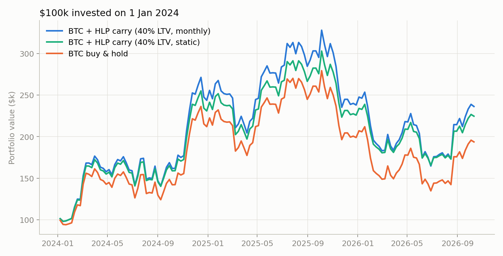
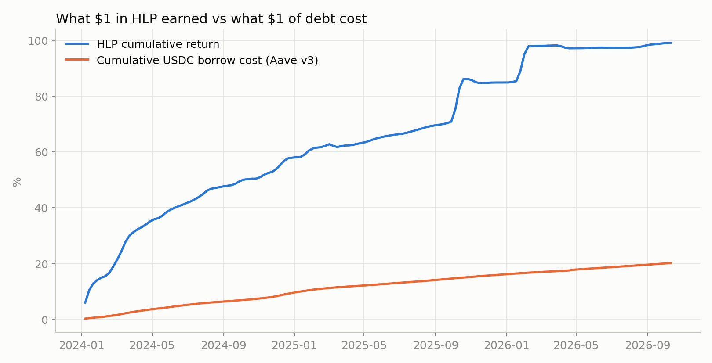
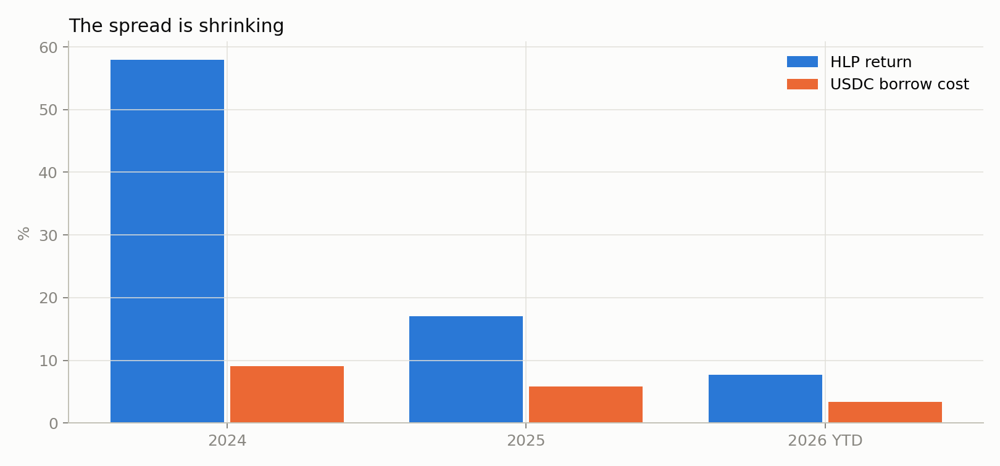
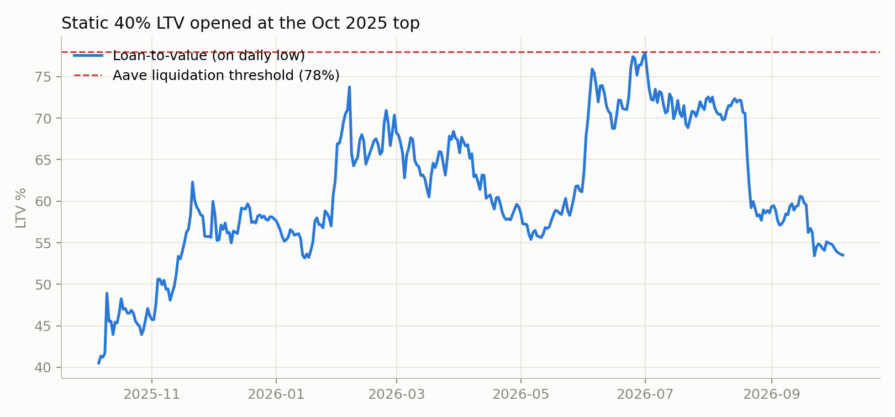

Backtest · BTC · Hyperliquid

# Paid to HODL: borrowing against Bitcoin to farm HLP

I hold Bitcoin for the long run, and most of the time it just sits there. So I tested a simple overlay: borrow 40% of its value in USDC and park it in Hyperliquid's HLP vault. Here is what 33 months of real data say.

**Achille Krotoff** · October 2026 · 10 min read

- **+36.5%** a year for BTC + HLP carry, vs +27.1% for plain BTC (Jan 2024 to Oct 2026)
- **$42.6k** extra on a $100k starting portfolio
- **−0.01** correlation between HLP returns and BTC returns
- **1** liquidation, for a static position opened at the October 2025 top

## The idea

My Bitcoin thesis is long-term and fundamental: fixed supply, a growing base of institutional holders since the spot ETFs, and a monetary asset that keeps absorbing shocks. I am not trying to trade it. That also means the coins are idle capital. They earn nothing while I wait.

DeFi lets you borrow against BTC without selling it. The usual move is to borrow stablecoins and buy more BTC, which is just leverage. I wanted something different: keep my BTC exposure at exactly 1x and put the borrowed dollars into something that earns more than the loan costs, ideally something that does not move with Bitcoin.

HLP, the Hyperliquidity Provider vault, fits that description on paper. It is the community vault that makes markets and takes over liquidations on Hyperliquid, the largest onchain perpetuals exchange. Depositors earn its trading PnL in USDC. Its returns depend on order flow and volatility, and much less on the direction of the market.

### The setup

1. Buy BTC and deposit it as collateral on Aave v3.
2. Borrow USDC equal to 40% of the BTC value. Aave liquidates WBTC positions at 78% loan-to-value, so this leaves a wide buffer.
3. Deposit the USDC into HLP.
4. Once a month, rebalance: reset the loan to 40% of the BTC value, and move any HLP profit above the debt back into BTC (or sell a little BTC if HLP is short of the debt).

Net exposure stays at one Bitcoin per Bitcoin of equity. Everything the overlay adds or loses comes from one number: the **spread between HLP's return and the USDC borrow rate**, applied to 40% of the portfolio.

## The results

I simulated $100,000 starting on 1 January 2024, day by day, using actual BTC prices, actual daily Aave v3 USDC borrow rates and HLP's own reported PnL. The main period starts in 2024 because HLP was small in 2023 (under $15M) and its early returns are too noisy to rely on. I included two comparisons: holding BTC alone, and taking the same $40k loan to buy more BTC (1.4x leverage).

Weekly closes. Carry uses a 40% loan-to-value; HLP gains, borrow interest and 10 bp trading costs included.

| Strategy | Final value | CAGR | Volatility | Sharpe | Max drawdown | Liquidations |
| --- | --- | --- | --- | --- | --- | --- |
| BTC buy & hold | $193.6k | 27.1% | 47.1% | 0.64 | −53.0% | 0 |
| Carry, static 40% | $224.5k | 34.1% | 42.3% | 0.78 | −46.6% | 0 |
| Carry, monthly 40% | $236.2k | 36.5% | 46.9% | 0.79 | −51.2% | 0 |
| 1.4x BTC (loan buys BTC) | $198.5k | 28.2% | 66.2% | 0.63 | −67.2% | 0 |

1 Jan 2024 to 6 Oct 2026. Sharpe uses the Aave USDC supply rate as the risk-free rate.

The carry overlay added about 9 points a year over plain BTC, and the drawdown was no worse. The comparison with 1.4x BTC is the one I find most telling. The same $40k loan, pointed at more Bitcoin, finished only $5k ahead of buy-and-hold while the worst drawdown deepened to −67%. Pointed at HLP, it finished $43k ahead. When BTC fell 53% from its October 2025 high, the HLP sleeve kept earning, so the loan never compounded the pain.

The full sample from June 2023 looks even better (57.7% a year vs 41.4%), but that comes from HLP's tiny early days, and I would not plan on seeing it again.

## Where the return comes from

On the monthly version, HLP earned $51.3k over the period and the loan cost $14.9k in interest. That $36k net carry, reinvested into BTC along the way, explains the whole gap with buy-and-hold. The chart below shows the two sides of the trade per dollar.

Cumulative, from 1 Jan 2024. HLP: +99%. Borrowing: +20%.

Two things stand out. First, the debt is a smooth, predictable cost. HLP's return comes in steps. Second, the biggest steps line up with Bitcoin's worst days. HLP's best two-week windows since 2024 include the October 2025 flash crash (+8.8% while BTC traded 14% lower intraperiod) and the February 2026 drop to $60k (+6.7% while BTC lost 18%). Liquidation cascades are when HLP earns the most, because it takes over liquidated positions and provides liquidity when everyone else steps back.

Measured over all 2024 to 2026 snapshots, the correlation between HLP returns and BTC returns is −0.01. Against BTC's worst intraperiod move it is −0.17: when BTC crashes harder, HLP tends to earn a little more. For someone who already owns BTC, that is the property that matters most.

> Over the last 12 months, HLP returned 13%. Strip out the two crash windows and it returned 0.4%, against a 4.6% cost of borrowing.

## The spread is shrinking

The yearly picture explains why the carry looks so strong in the headline numbers.

2026 runs to 6 October (279 days); borrow cost is pro-rated to match.

2024 was exceptional: HLP returned 58% while the vault grew from $11M to $400M. In 2025 the spread fell to about 11 points. In 2026 it is about 4 points year to date, and nearly all of it came in a single two-week window in early February. Since mid-February, HLP's PnL has been flat while the loan kept costing around 4.4% a year. For close to eight months, the overlay has been losing money.

This is what you would expect. HLP is now a $180M to $600M vault competing with professional market makers on a much bigger exchange. More capital chasing the same order flow means a lower yield per dollar. I would treat 2024 as a one-off and size the strategy around the recent years.

## The risk that matters: liquidation

The monthly rebalance is what kept this strategy safe. When BTC falls, the loan-to-value rises; at month end the strategy pulls USDC from HLP to repay part of the loan and brings it back to 40%. Across the whole period, the monthly version never went above 52% LTV.

The static version tells a different story when it starts at the wrong time. Here is a 40% LTV position opened at the BTC high of $124,659 on 6 October 2025 and never touched.

Liquidated on 5 February 2026, when BTC touched $62,345, a 50% fall from entry. Accrued interest pushed the threshold slightly closer than the 49% you would compute on day one.

A 40% LTV survives a 49% fall in BTC. Bitcoin has fallen more than that in every previous cycle, and in this one it fell exactly that much. The rebalanced version survives because the loan shrinks along with the BTC position: after a fall, part of the HLP balance repays part of the loan and LTV goes back to 40%. The weak spot is timing. Between two rebalances, a fast crash can still push LTV up, which is why I would add a trigger on top of the monthly schedule.

### How much to borrow

I ran the monthly version at different loan sizes over the same period.

| Loan-to-value | CAGR | Sharpe | Max drawdown | Peak LTV | Liquidations | BTC drop to liquidate |
| --- | --- | --- | --- | --- | --- | --- |
| 0% (BTC only) | 27.1% | 0.64 | −53.0% | 0% | 0 | never |
| 20% | 31.7% | 0.71 | −52.1% | 26% | 0 | 74% |
| 30% | 34.1% | 0.75 | −51.6% | 39% | 0 | 62% |
| 40% | 36.5% | 0.79 | −51.2% | 52% | 0 | 49% |
| 50% | 39.0% | 0.83 | −50.7% | 65% | 0 | 36% |
| 60% | 28.4% | 0.66 | −56.3% | 76% | 4 | 23% |
| 70% | 17.1% | 0.46 | −57.9% | 82% | 16 | 10% |

Monthly rebalance, 1 Jan 2024 to 6 Oct 2026. "BTC drop to liquidate" is measured from each rebalance.

Returns rise steadily up to 50%, then fall apart. At 60%, a normal one-month BTC move is enough to trigger liquidations, and each one costs a 5% liquidation penalty. 50% was the best number in this sample, but a 36% monthly drop is not an exotic event for Bitcoin. I would stay between 30% and 40%.

### Did the start date matter?

I re-ran the monthly strategy over every 12-month window starting every two weeks from June 2023 (62 windows). The carry version beat plain BTC in all 62. The median outperformance was 5.8 points and the worst was 2.8 points. The best, 82 points, came from a window starting in 2023, when HLP was still small. Since HLP's gains arrive in bursts, the result depends on staying in the trade long enough to catch them.

## What the backtest does not capture

### An HLP blow-up

HLP has taken real hits: a $4M loss in March 2025 when a whale used leverage to exit a large ETH position, and the JELLY squeeze later that month, which validators ended by delisting the market. Neither showed up as a large loss in the data. A truly bad event could. Forcing a 20% one-day HLP loss into the monthly simulation cut final equity by 7.3%, which hurts but is survivable. A total loss of the HLP sleeve would mean losing 40% of starting equity in dollars while the BTC loan is still owed.

### The 4-day lockup

HLP deposits are locked for four days after each deposit. In a crash you cannot pull USDC out of HLP the same day to repay the loan. Keep a separate USDC or BTC buffer for emergencies.

### Borrow rate spikes

Aave's USDC borrow rate has a median of 5.3% since 2023 but hit 28% on a daily average. Spikes are short and tend to come in euphoric markets, but a few days at those rates can wipe out weeks of spread.

### Plumbing

The test borrows on Aave (Ethereum) and deposits on Hyperliquid. In practice that means a bridge, smart contract risk on both sides, and Hyperliquid's own validator set. HyperEVM lending markets avoid the bridge but have shorter rate histories.

### Data granularity and hindsight

Hyperliquid only publishes about 100 snapshots of HLP's history (every 7 to 14 days), so short drawdowns between snapshots are smoothed out. I picked HLP knowing it survived. Taxes, gas and bridge fees are ignored.

## How I would run it

The backtest supports the core idea: an uncorrelated USDC yield, funded by a moderate loan against BTC, improved returns without making the drawdown worse. It also says the easy part of the trade is over. Here is the version I would actually run:

1. **Borrow 30 to 40%**, never more. The extra return from 50% is not worth losing the buffer.
2. **Rebalance monthly, and also on a trigger:** if LTV goes above 55%, repay immediately from a reserve kept outside HLP.
3. **Judge the spread over 6 to 12 months.** A three-month filter (exit when HLP trails the borrow rate) would have closed the trade in mid-January 2026, about three weeks before the February window that paid for most of this year's carry.
4. **Size for HLP going to zero.** If losing the HLP sleeve would force me to sell BTC at the bottom, the loan is too big.

The way I think about it now: HLP behaves like insurance for BTC holders. It pays out in chaos and earns little in calm markets. Holding it with borrowed money is a bet that crashes keep happening and that Hyperliquid keeps getting paid for them. So far that bet has paid. The open question is how much it will pay as more capital crowds into the vault.

## Methodology

- **BTC:** Binance BTC/USDT daily closes, with daily lows used for liquidation checks.
- **Borrow rate:** Aave v3 Ethereum USDC variable borrow rate, daily average of `ReserveDataUpdated` events ([Dune query](https://dune.com/queries/8907946)). Interest accrues daily on the outstanding loan.
- **HLP:** Hyperliquid `vaultDetails` API for vault `0xdfc2…f303`. Each snapshot interval's return is computed with the Modified Dietz method, so deposits and withdrawals do not show up as performance, then spread evenly over the days of the interval.
- **Liquidation:** 78% threshold, 50% of the debt closed per event, 5% penalty on seized BTC. HLP is not counted as collateral.
- **Costs:** 10 bp on every BTC trade. No gas, bridge fees or taxes.
- **Period:** 1 January 2024 to 6 October 2026 for headline figures; June 2023 onward for the full-history and rolling-window checks.

This is a personal research note and not investment advice. Borrowing against crypto can lose more than the borrowed amount, and past HLP returns say little about future ones.
